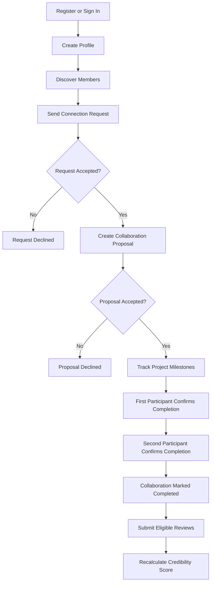

# CollabLevel

## Product Requirements Document (PRD)

**Project Type:** Professional Collaboration Platform
**Document Purpose:** Academic Project Review and Technical Documentation

---

## 1. Project Overview

### 1.1 Introduction

CollabLevel is a professional collaboration platform designed to help individuals, creators, startups, brands, agencies, and other organizations discover potential partners, manage collaborations, track milestones, and establish credibility through verified collaboration history and reviews.

The platform provides a structured workflow from connecting with another user to completing a project and reviewing the collaboration.

### 1.2 Problem Statement

Traditional networking platforms primarily focus on professional profiles, content sharing, or recruitment. They often lack an integrated system for managing collaborations, tracking deliverables, confirming project completion, and linking reviews to actual completed work.

This can make it difficult to establish trust, monitor progress, and evaluate potential collaboration partners.

### 1.3 Proposed Solution

CollabLevel addresses these challenges by providing:

* Professional profiles and member discovery.
* Connection requests between users.
* Structured collaboration proposals.
* Milestone-based project tracking.
* Mutual completion confirmation.
* Reviews and ratings linked to eligible collaborations.
* A credibility score based on collaboration activity and profile information.

---

## 2. Project Objectives

The main objectives of CollabLevel are to:

1. Help users discover suitable collaboration partners.
2. Simplify the process of initiating and managing collaborations.
3. Organize project deliverables and milestones.
4. Improve accountability through mutual completion confirmation.
5. Make reviews more meaningful by linking them to completed collaborations.
6. Provide a credibility score based on defined criteria.
7. Create a professional environment for cross-industry collaboration.

---

## 3. Target Users

CollabLevel is designed for the following user categories:

| User Category                     | Intended Use                                                 |
| --------------------------------- | ------------------------------------------------------------ |
| Brands and Companies              | Find creators, agencies, and professional partners.          |
| Startups                          | Connect with freelancers, marketers, and other startups.     |
| Creators and Influencers          | Discover brands and partners for collaborative projects.     |
| Models and Artists                | Find creative opportunities and professional collaborations. |
| Agencies                          | Connect with clients and other service providers.            |
| Marketers                         | Collaborate on marketing and growth projects.                |
| Independent Professionals         | Find clients and partners for freelance projects.            |
| Clubs and Community Organizations | Organize partnerships and joint initiatives.                 |

---

## 4. Technology Stack

The following technologies are identified in the supplied project report. Versions should be confirmed against the current project configuration before formal submission.

| Component            | Technology               | Purpose                                                |
| -------------------- | ------------------------ | ------------------------------------------------------ |
| Frontend Framework   | TanStack Start and React | Build the application interface and routing.           |
| Programming Language | TypeScript               | Provide type safety in application code.               |
| Build Tool           | Vite                     | Support development and production builds.             |
| Styling Framework    | Tailwind CSS v4          | Implement styling and the design system.               |
| UI Components        | Radix UI                 | Provide accessible interface primitives.               |
| Icons                | Lucide React             | Display interface icons.                               |
| Form Management      | React Hook Form          | Manage form state and submissions.                     |
| Validation           | Zod                      | Validate form data.                                    |
| Data Fetching        | TanStack Query           | Manage server data and client-side caching.            |
| Backend and Database | Supabase and PostgreSQL  | Store application data and support backend operations. |
| Authentication       | Supabase Auth            | Manage registration, login, and sessions.              |
| Testing              | Vitest                   | Support automated testing.                             |
| Development Platform | Lovable                  | Support application development and previewing.        |

**Architecture summary:** The application uses a React-based frontend and Supabase backend, with PostgreSQL providing persistent data storage and database-level business logic.

---

## 5. Functional Requirements

| ID    | Feature                 | Description                                                       | Reported Status                                                            |
| ----- | ----------------------- | ----------------------------------------------------------------- | -------------------------------------------------------------------------- |
| FR-01 | User Authentication     | Register, sign in, and manage sessions.                           | Implemented; end-to-end verification required.                             |
| FR-02 | Profile Management      | Create and update professional profiles.                          | Implemented; verification required.                                        |
| FR-03 | Member Discovery        | Search and explore potential collaborators.                       | Implemented; verify available filters.                                     |
| FR-04 | Connections             | Send, accept, and decline connection requests.                    | Implemented; verification required.                                        |
| FR-05 | Collaboration Proposals | Create proposals containing project details and terms.            | Implemented; verification required.                                        |
| FR-06 | Milestone Tracking      | Organize and track project milestones.                            | Implemented; verification required.                                        |
| FR-07 | Completion Confirmation | Require both participants to confirm completion.                  | Reported implemented; test with two accounts.                              |
| FR-08 | Reviews and Ratings     | Allow eligible participants to review one another.                | Reported implemented; test with two accounts.                              |
| FR-09 | Credibility Score       | Calculate scores from defined profile and collaboration criteria. | Reported implemented; verify calculations.                                 |
| FR-10 | Notifications           | Inform users about relevant activity.                             | Reported as demo/mock functionality; persistent implementation unverified. |
| FR-11 | Identity Verification   | Display verification-related information or badges.               | Verification workflow incomplete or unverified.                            |

---

## 6. Core Business Rules

CollabLevel is designed around the following rules:

1. **Connection Requirement:** Users must have an accepted connection before proposing a collaboration.
2. **Mutual Completion:** Both participants must confirm completion before a collaboration can be marked completed.
3. **Review Eligibility:** Reviews are restricted to participants in eligible completed collaborations.
4. **Duplicate Review Prevention:** Each participant can submit at most one review per collaboration, according to the reported database constraint.
5. **Protected Credibility Score:** The score is calculated through backend database logic rather than being directly controlled by ordinary users.
6. **Participant Permissions:** Collaboration records and milestones should only be accessible to authorized participants.
7. **Profile Ownership:** Users should only be able to edit their own profiles, subject to the application's permission rules.

These rules are based on the supplied project report and should be confirmed against the current implementation.

---

## 7. Credibility Scoring System

CollabLevel uses a reported credibility score ranging from **0 to 100**.

The score is intended to represent a user's collaboration history, feedback, profile completeness, and responsiveness.

| Scoring Component        | Maximum Points | Description                                                           |
| ------------------------ | -------------: | --------------------------------------------------------------------- |
| Completed Collaborations |             40 | 10 points per completed collaboration, capped at four collaborations. |
| Reviews                  |             30 | Based on the average eligible review rating.                          |
| Profile Completeness     |             15 | Based on the completion of selected profile fields.                   |
| Responsiveness           |             15 | Based on response timing for incoming connection requests.            |
| **Total**                |        **100** | **Overall credibility score.**                                        |

The score is intended to help users assess potential partners using more than profile information alone.

The exact scoring formula should be verified against the current database functions before being presented as independently validated.

---

## 8. Application Workflow

### 8.1 Step-by-Step Workflow

**Step 1 — Registration**
A user creates an account and signs in.

**Step 2 — Profile Creation**
The user adds professional information, skills, interests, and portfolio details.

**Step 3 — Member Discovery**
The user searches for potential collaboration partners.

**Step 4 — Connection Request**
The user sends a connection request to another member.

**Step 5 — Connection Response**
The recipient accepts or declines the request.

**Step 6 — Collaboration Proposal**
Connected users create a proposal describing the project scope, deliverables, dates, compensation terms, and milestones.

**Step 7 — Proposal Acceptance**
The invited participant accepts or declines the proposal.

**Step 8 — Milestone Tracking**
Participants monitor project progress and update milestones.

**Step 9 — Mutual Completion Confirmation**
Both participants independently confirm that the collaboration is complete.

**Step 10 — Reviews and Ratings**
Eligible participants submit ratings and feedback.

**Step 11 — Credibility Update**
The application recalculates the credibility score using the relevant records.

### 8.2 Workflow Diagram

---

## 9. Special Features

### 9.1 Mutual Completion Confirmation

A collaboration is designed to require confirmation from both participants before being marked completed. This reduces reliance on a single participant's claim that the work is finished.

### 9.2 Reviews Linked to Completed Work

Reviews are intended to be available only after an eligible collaboration has been completed, helping connect feedback to actual collaboration activity.

### 9.3 Credibility Score

The scoring system combines completed collaborations, reviews, profile completeness, and responsiveness into one score.

### 9.4 Structured Collaboration Management

The platform brings proposals, deliverables, milestones, and completion into a single workflow rather than leaving all project details unstructured.

### 9.5 Cross-Industry Collaboration

CollabLevel is intended to support professionals and organizations across multiple industries, including creators, startups, brands, agencies, and independent professionals.

---

## 10. Security and Data Management

The reported architecture uses Supabase Auth and PostgreSQL Row Level Security (RLS) to support authentication and access control.

Important security goals include:

* Restricting profile edits to the profile owner.
* Restricting collaboration access to authorized participants.
* Validating review eligibility.
* Protecting credibility scores from unauthorized changes.
* Enforcing important business rules at the database level where appropriate.

The existence of these controls does not, by itself, prove that the entire application has passed a security audit. Database permissions and core workflows should be tested before public launch.

---

## 11. Current Limitations and Future Improvements

| Area                  | Current Understanding                         | Future Work                                                 |
| --------------------- | --------------------------------------------- | ----------------------------------------------------------- |
| Notifications         | Reported to use demo or local state.          | Implement and verify persistent notifications.              |
| Identity Verification | Verification-related UI is reported to exist. | Build or verify a complete verification process.            |
| Direct Messaging      | Described as future work.                     | Consider real-time messaging between collaborators.         |
| Payments and Escrow   | Payment processing is not reported as active. | Evaluate secure payment integration if needed.              |
| End-to-End Testing    | Full two-user testing has not been confirmed. | Test the complete workflow with separate accounts.          |
| Responsive Design     | Requires further verification.                | Test on desktop, tablet, and mobile devices.                |
| Security              | Database controls are reported to exist.      | Review RLS policies, permissions, and protected operations. |

---

## 12. Non-Functional Requirements

CollabLevel should aim to meet the following quality requirements:

* **Security:** Enforce access permissions in the backend and database.
* **Data Integrity:** Keep collaboration states, reviews, and credibility calculations consistent.
* **Usability:** Provide a clear and understandable workflow.
* **Reliability:** Preserve important records across sessions and page refreshes.
* **Maintainability:** Keep application code and database logic organized.
* **Responsiveness:** Support common desktop, tablet, and mobile screen sizes.
* **Privacy:** Restrict access to information according to intended user permissions.

These are requirements and evaluation goals, not claims that every quality has already been tested.

---

## 13. Success Criteria

The project can be evaluated against the following criteria:

1. Users can register, sign in, and maintain their profiles.
2. Two users can exchange and respond to connection requests.
3. Accepted connections can create collaboration proposals.
4. Participants can track milestones.
5. A collaboration cannot be completed until both participants confirm completion.
6. Only eligible participants can submit reviews.
7. Credibility scores update correctly after relevant activity.
8. Important records persist after page refreshes and new sessions.
9. Unauthorized users cannot access or modify restricted records.
10. The main workflow is usable on desktop and mobile devices.

---

## 14. Conclusion

CollabLevel aims to make professional collaboration more structured, transparent, and accountable. Its central workflow connects member discovery, connection requests, collaboration proposals, milestone tracking, mutual completion confirmation, reviews, and credibility scoring.

Its main differentiator is the effort to connect professional credibility to recorded collaboration activity rather than relying solely on unverified profile claims.

Before the application is presented as production-ready, the core workflow should be tested end-to-end, database permissions should be reviewed, and incomplete areas such as notifications and identity verification should be verified.

---

**End of Document**
