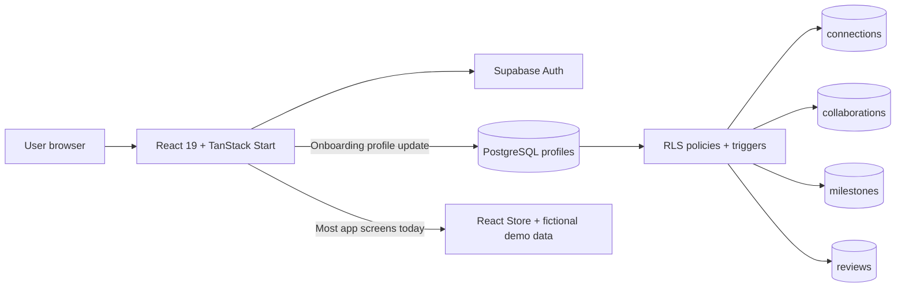

# CollabLevel — Code-Accurate Viva Preparation

This guide compares the supplied PRD with the repository at commit `c20d91f`. Use it for an academic presentation or viva. It separates the **implemented prototype** from the **database design ready for integration**.

## 1. The project in one minute

> CollabLevel is a professional collaboration platform for brands, startups, creators, artists, agencies, marketers, independent professionals, and community organisations. Its goal is to turn professional networking into a structured workflow: users create a profile, find suitable partners, connect, propose a project, track milestones, mutually confirm completion, and then build credibility from the collaboration record and feedback.
>
> The frontend uses React and TypeScript with TanStack Start, TanStack Router, Tailwind CSS, Radix UI components, Zod validation, and Supabase authentication. The repository also defines a PostgreSQL schema with Row Level Security and database triggers for profiles, connections, collaborations, milestones, reviews, and credibility protection.
>
> In the current version, authentication and onboarding profile updates connect to Supabase. The discovery and collaboration workspace are a realistic frontend prototype driven by in-memory demo data. The next implementation phase is to replace this demo store with Supabase queries and mutations, then test the workflow using two real accounts.

## 2. Architecture: what is real today

The important distinction is the solid and dotted boundary: the schema supports the full workflow, but the current UI has not yet wired its connection, collaboration, milestone, review, and notification actions to those database tables.

## 3. Stack actually present in the repository

| Layer | Technology | Evidence in the code | Use it to explain |
|---|---|---|---|
| Frontend | React 19, TypeScript | `package.json`, `src/routes/*.tsx` | Component based, typed UI. |
| Application framework | TanStack Start and TanStack Router | `src/start.ts`, `src/router.tsx`, file routes | File based routes and protected application shell. |
| Styling | Tailwind CSS 4 | `src/styles.css` | Responsive layouts and custom design tokens. |
| Accessible UI | Radix UI and local shadcn-style components | `src/components/ui`, `components.json` | Dialogs, form controls, menus, etc. |
| Icons and notifications | Lucide React, Sonner | route and component imports | Icons and toast feedback. |
| Forms | Native HTML forms + FormData + Zod | signup, signin, onboarding, proposal and settings routes | Client-side validation. |
| Backend | Supabase Auth and PostgreSQL | `src/integrations/supabase`, `supabase/migrations` | Email/password auth and persistence design. |
| Server data cache | TanStack Query | `src/routes/app.tsx` | Fetches signed-in user name and account type in the sidebar. |
| Testing | Vitest + Testing Library | `vitest.config.ts`, one routing test | Test foundation, not full end-to-end coverage. |
| Development platform | Lovable | `vite.config.ts`, `AGENTS.md` | Connected Lovable project configuration. |

Do **not** say that React Hook Form manages the current forms. It is a dependency, but the application uses native forms and `FormData`; no source file imports React Hook Form.

## 4. Route map and screen purpose

| Route | Purpose | Current data source |
|---|---|---|
| `/` | Landing page, account types, levels, trust principles | Demo profiles and scores. |
| `/signup` | Register with account type, name, email and password | Supabase Auth. |
| `/signin` | Email/password sign-in | Supabase Auth. |
| `/onboarding` | Two-step professional profile setup | Writes selected profile fields to Supabase. |
| `/app/dashboard` | Score, suggestions, requests and active work summary | Demo store. |
| `/app/discover` | Search/filter collaborator profiles | Demo store. |
| `/app/connections` | Accepted, incoming and sent connection requests | Demo store. |
| `/app/collaborations` | Incoming, sent, active and completed work | Demo store. |
| `/app/collaborations/new` | Create a proposal for a connected partner | Demo store. |
| `/app/collaborations/:id` | Deliverables, milestones and completion confirmation | Demo store. |
| `/app/credibility` | Score breakdown, levels, review display | Demo store. |
| `/app/notifications` | Activity list and mark-as-read | Demo store. |
| `/app/profile/:id` | Public-looking profile, portfolio and work history | Demo store, except own sidebar name/type query. |
| `/app/settings` | Profile edits and notification preferences | Demo store. |

## 5. Exact workflow to explain in a demo

### A. Registration and profile creation

1. The user chooses one of eight account types, then enters name, email and password.
2. Zod validates the input before the app calls `supabase.auth.signUp`.
3. The signup metadata contains `name` and `account_type`.
4. The `handle_new_user` PostgreSQL trigger creates a minimal `profiles` row for the authenticated user. It creates a unique handle from the name plus part of the UUID.
5. If email confirmation is enabled, the user confirms the email, then signs in.
6. In onboarding, the user enters headline, location, industry, skills and a type-specific field such as audience size or company size.
7. Onboarding updates the signed-in user’s Supabase profile row.

Good explanation: “Signup creates the authentication identity, and a database trigger creates the application profile. That avoids relying on the frontend to remember to create the profile.”

### B. Discover and connect

1. Discover filters profiles by free-text search, account type, industry and minimum credibility level.
2. Clicking Connect adds a sent request.
3. The recipient sees an incoming request and can accept or decline it.
4. Once accepted, the connection can be selected as a proposal partner.

The UI demonstrates this correctly, but it uses React state. The database design has `connections(requester_id, addressee_id, status, note)` and a unique unordered pair index, so two users cannot create duplicate connections in opposite directions.

### C. Propose a collaboration

1. The proposal form lists only accepted connections.
2. The proposer supplies a partner, title, purpose, deliverables, start date, end date and optional compensation.
3. Zod rejects an empty partner, short purpose, missing deliverables, missing dates, and an end date before the start date.
4. In the prototype, submission creates a local `sent` proposal and automatically adds a Kick-off milestone.
5. The recipient can accept or decline. Acceptance moves the proposal to Active.

The database represents the initial state as `proposed`; the UI calls the current user’s outgoing state `sent` and the recipient’s view `incoming`.

### D. Milestones and completion

1. An active project displays its purpose, deliverables, dates, compensation and milestones.
2. The prototype lets a user tick milestones complete.
3. The completion button remains disabled until all milestones are done.
4. Each participant independently confirms completion.
5. The database trigger changes the status to `completed` only when both confirmation booleans are true.

Strong answer: “The key trust rule is mutual confirmation. A single person cannot make the project count as completed. The backend trigger owns the final status transition.”

### E. Reviews and credibility

1. Only a completed collaboration should permit reviews.
2. The database has a unique constraint on `(collaboration_id, author_id)`, so each participant can write one review per collaboration.
3. A `validate_review` trigger rejects reviews for incomplete projects or from someone who was not one of the two participants.
4. Inserting a review invokes a trigger that recalculates the reviewed participant’s credibility score.

The current Credibility page displays a sample review and demo score. There is no review-submission UI yet.

## 6. Database design and security

| Table | Main responsibility | Key integrity and access controls |
|---|---|---|
| `profiles` | Professional account data and score | Owner can insert/update own profile; signed-in users can read profiles; verification and score are protected in a trigger. |
| `connections` | Requests and accepted professional relationships | Participants can view/delete; only requester creates a pending request; only recipient updates response; unique pair index prevents duplicates. |
| `collaborations` | Project terms, status, participants and completion flags | Participants can view and update; trigger blocks invalid transitions, locks terms after activation and auto-completes after both confirmations. |
| `milestones` | Ordered project tasks | RLS checks collaboration participation through a security-definer helper; trigger blocks edits after closed state. |
| `reviews` | Rating and written review | Anybody authenticated can read; database trigger ensures completed project, valid participant pairing and one review per author. |

### Security details worth mentioning

- Row Level Security is enabled on every product table.
- A user cannot update someone else’s profile.
- A user cannot directly set their own verification badge or credibility score; the profile trigger restores protected values.
- Connections can be changed only by the recipient, and only while they are pending.
- A collaboration cannot become completed by manually setting its status. Both completion flags must be true while it is active.
- Milestone policies rely on a `private.is_collab_participant` function so only project participants can access those rows.
- Review validation is in PostgreSQL, so the rule remains enforced even if a client bypasses the interface.

## 7. Credibility: correct the PRD before presenting it

The PRD’s stated formula is **not the formula currently implemented in SQL**.

| Layer | What it says/does |
|---|---|
| Product idea and demo UI | Shows four categories: completed collaborations (40), eligible reviews (30), profile completeness (15), and responsiveness (15). |
| Actual SQL function `recalculate_credibility` | `round((average_rating / 5) * 60) + min(completed_collaborations, 8) * 5`, capped at 100. |

So the current database score has:

- Up to **60** points from the average received review rating.
- Up to **40** points from completed collaborations, at **5 points each**, capped at 8.
- No current SQL contribution from profile completeness or responsiveness.

Say this in a viva:

> “The screen shows the intended four-part scoring model. The current SQL implementation is an earlier placeholder formula that uses average reviews and completed collaborations. Aligning the frontend explanation and backend formula is an identified next task.”

Do not claim “10 points per completed collaboration, capped at four” or “30 review points plus 15 completeness plus 15 responsiveness” as implemented backend behavior.

## 8. PRD requirement status: evidence-based version

| ID | Requirement | Accurate current status |
|---|---|---|
| FR-01 | Authentication | Implemented in UI with Supabase signup, sign-in, persistent browser session and sign-out. Email confirmation depends on Supabase project settings. |
| FR-02 | Profile management | Profile row is created by an auth trigger; onboarding writes selected fields. The Settings screen itself only changes local demo state. |
| FR-03 | Discovery | Implemented as filtering against seven fictional demo profiles; database backed discovery remains to be connected. |
| FR-04 | Connections | UI prototype works in current browser session. Database schema/RLS exists, but screen actions do not call it. |
| FR-05 | Proposals | UI validation and local state flow work. Schema/RLS exists, but proposal creation is not persisted. |
| FR-06 | Milestones | Local toggle UI works. Schema/RLS exists, but no milestone query or mutation is wired. |
| FR-07 | Mutual completion | Database trigger implements it; UI demonstrates only the current user’s confirmation against demo partner data. Two-user end-to-end flow remains untested. |
| FR-08 | Reviews and ratings | Database constraint and validation trigger exist; no UI lets a user submit a review. Current page displays sample data. |
| FR-09 | Credibility | Protected score column and recalculation triggers exist; formula differs from PRD and frontend score is demo data. |
| FR-10 | Notifications | Demo/local-state only. No `notifications` table exists in the migrations. |
| FR-11 | Identity verification | Badge states exist (`unverified`, `pending`, `verified`); no verification submission or review workflow exists. |

## 9. Important gaps to acknowledge before an evaluator identifies them

1. `StoreProvider` initializes all collaboration information from `demo-data.ts`, and its comment says nothing persists yet.
2. The app shell tells the user that profiles, connections, collaborations and reviews shown in the workspace are fictional and reset on refresh.
3. The database supports connections and collaboration records, but no screen calls `supabase.from('connections')`, `supabase.from('collaborations')`, `supabase.from('milestones')`, or `supabase.from('reviews')`.
4. There is only one automated test, which checks that the landing route matches; there is no two-user or database integration test.
5. Notifications have no database schema or delivery mechanism.
6. Verification is a stored state and badge, without an evidence upload or approval process.
7. The `requireSupabaseAuth` server middleware is defined but is not used by a server function in the visible application flows.
8. The current collaboration INSERT policy does not itself enforce that the two users have an accepted connection. The UI enforces that rule by showing only connected partners; production backend should enforce it too.

## 10. Questions an examiner may ask

### Why use a database trigger to create a profile?

Because an authenticated user and their application profile must stay aligned. The trigger runs after an auth user is created and inserts a minimal profile automatically. This avoids orphaned accounts when a client flow fails after sign-up.

### How do you prevent users from changing their score?

The `profiles_guard` trigger restores the old verification and credibility values during ordinary updates. The credibility function uses an internal database setting to perform authorized score updates. Only service-role/internal operations can bypass that protection.

### How do you prevent fake reviews?

The review trigger checks three things: the collaboration exists and is completed, the reviewer is one of its participants, and the review subject is the other participant. The table also has a unique constraint that allows one review per author for a collaboration.

### How do you prevent unauthorised milestone access?

RLS policies call a private helper that checks whether `auth.uid()` is the collaboration proposer or partner. Only participants can select, create, edit or delete a milestone.

### Is the dashboard score live?

Not yet. The dashboard reads a preset score from demo data. The database has a separate protected score column and recalculation function, which must be connected to the frontend.

### Why split verification and credibility?

Verification answers “is this identity verified?” Credibility answers “what collaboration record and feedback has this person earned?” Keeping them separate avoids treating identity proof as proof of professional performance.

### What is your next technical milestone?

Replace the in-memory store with typed Supabase queries/mutations, starting with profiles and connections. Then wire collaborations and milestones, build a review form, align the scoring formula with the product requirements, add persistent notifications, and test the workflow with two accounts under RLS.

## 11. Safer live demo order

1. Open the landing page: explain audience, professional collaboration focus, and five levels.
2. Show signup fields and the eight account types. Explain Supabase Auth and the profile-creation trigger.
3. Show onboarding and describe the real profile update.
4. Sign in and show the responsive app shell.
5. On Discover, demonstrate text/type/industry/level filters using the clearly marked demo profiles.
6. On Connections, explain the intended request lifecycle.
7. Open New collaboration: show validation, deliverables, dates and compensation scope.
8. Open an active collaboration: show milestone progress and dual completion concept.
9. Open Credibility: explain levels, separate verification and the current formula discrepancy transparently.
10. Finish with the schema and RLS rules as the backend architecture ready for the persistence phase.

## 12. Files to cite if asked for evidence

| Topic | Main files |
|---|---|
| Domain types and levels | `src/lib/types.ts` |
| Demo state and limitation | `src/lib/store.tsx`, `src/lib/demo-data.ts` |
| Signup/sign-in | `src/routes/signup.tsx`, `src/routes/signin.tsx` |
| Onboarding persistence | `src/routes/onboarding.tsx` |
| Authenticated app gate | `src/routes/app.tsx` |
| Connection/proposal/milestone UI | `src/routes/app.connections.tsx`, `src/routes/app.collaborations.new.tsx`, `src/routes/app.collaborations.$id.tsx` |
| Credibility UI | `src/routes/app.credibility.tsx` |
| Schema, RLS, triggers, score formula | `supabase/migrations/20261027013143_601d69b6-c4db-4832-945d-03605bff64ce.sql` |
| New user profile trigger | `supabase/migrations/20261027040227_97cf735c-6bde-47d2-8847-6a50245a8a4b.sql` |
| Private milestone participant helper | `supabase/migrations/20261027035858_0cf882fb-e4cc-4103-baee-3bd0f9453e9f.sql` |

## 13. Final close

> CollabLevel’s strength is a clearly modelled trust workflow. The data model and RLS rules demonstrate how a real collaboration platform can prevent invalid state changes, fake reviews, and direct score manipulation. The current frontend successfully communicates that product experience using demo data. The remaining engineering work is to connect every user action to the already designed Supabase schema, align the credibility implementation with the approved rules, and verify all critical paths with two real accounts.
